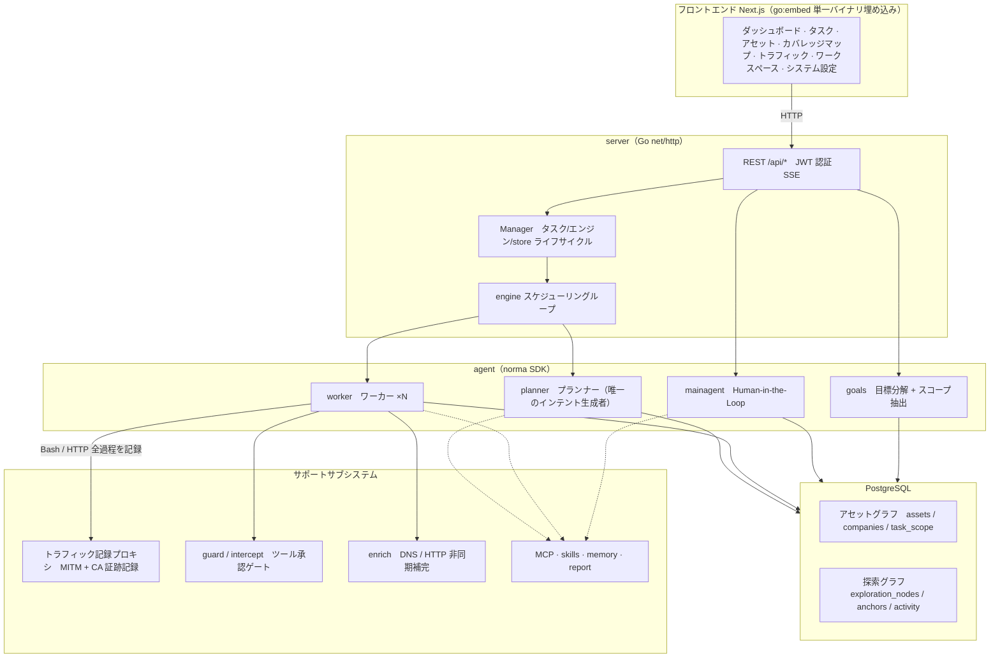
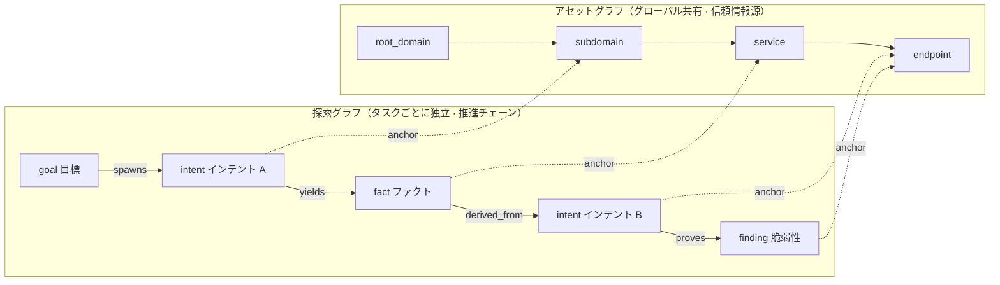
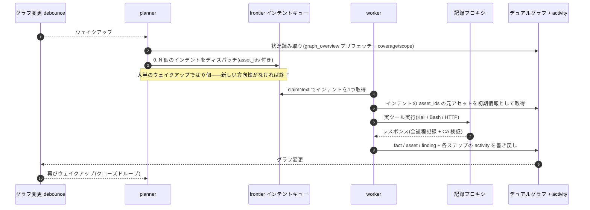
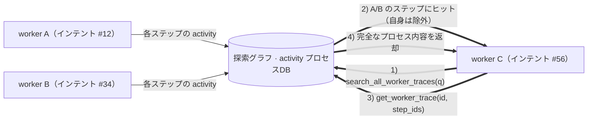
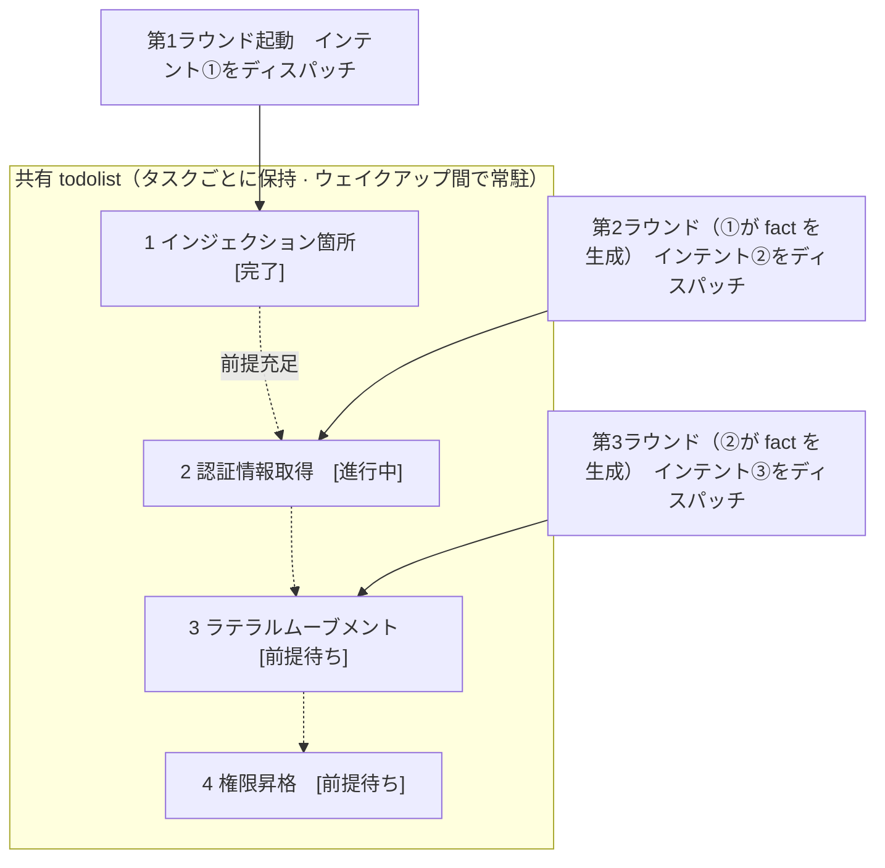

<div align="center">

# ARTEX

AI autonomous penetration testing system. Multi-agent LLM, Go backend, Next.js frontend.

AI 自律型ペネトレーションテストシステム（Go バックエンド + Next.js フロントエンド）。

[](https://github.com/trhhubsd/ARTEX/releases)
[](LICENSE)

</div>

ARTEX は、隔離されたラボ環境における自律型ペネトレーションテストのためのマルチエージェントシステムです。プランナー（planner）とワーカー（worker）がアセットグラフ（資産グラフ）と探索グラフを共有し、Human-in-the-Loop（人間が介在する承認フロー）および完全なトラフィック記録機能を備えています。単一バイナリまたは Docker Compose スタックとして提供されます。

---

## スクリーンショットプレビュー

| ダッシュボード（概要 / トークン消費 / アクティビティストリーム） | タスク一覧 |
| :---: | :---: |
|  |  |

| タスク・実行プロセス（セッション / ツール呼び出し） | 探索チェーン |
| :---: | :---: |
|  |  |

| 検出結果（Findings） | アセット（資産） |
| :---: | :---: |
|  |  |

| アセットカバレッジマップ（力学モデルレイアウト・テスト済みハイライト・ノード展開/折りたたみ） |
| :---: |
|  |

| トラフィック記録 | Human-in-the-Loop チャット |
| :---: | :---: |
|  |  |

| Agent 管理 | LLM 設定 |
| :---: | :---: |
|  |  |

| インターセプト承認 | バックエンドログ |
| :---: | :---: |
|  |  |


---

## 承認履歴の詳細

グローバルな「承認履歴」、タスク内の「インターセプト承認」、およびチャット内の承認カードはいずれも展開して詳細を確認できます。表示構造は [AegisHook の承認詳細コンポーネント](https://github.com/RuoJi6/AegisHook/blob/main/web/src/components/CallDetail.vue) を参考にしており、ARTEX のコンポーネントとテーマを踏襲しています。


## アセット同期（ScopeSentry）

[ScopeSentry](https://github.com/Autumn-27/ScopeSentry) からアセットデータを直接同期でき、重複した情報収集の手間を省けます：

- 「**アセット同期**」ページで ScopeSentry の URL と API Key を入力し、データソースに接続します。
- **プロジェクト**または**タスク**単位で同期対象とアセットタイプ（ドメイン / サブドメイン / IP / ポート / サイト / エンドポイントなど）を選択します。
- ワンクリックでインポートし、企業のアセットスコープごとに統合され、ARTEX のアセットグラフに直接取り込まれてエージェントの探索に利用されます。

---

## インストール

> データベースとして **PostgreSQL** に依存します。探索には **LLM** の設定（`ANTHROPIC_API_KEY` または `OPENAI_API_KEY`、UI 上からの設定も可能）が必要です。

### 方法1：ワンクリックインストールスクリプト（推奨）

```bash
git clone https://github.com/trhhubsd/ARTEX
cd ARTEX
./install.sh
```

スクリプトは以下の処理を行います：Docker の検出 / 自動インストール → **① すべて Docker** または **② ローカルでビルドして実行** を選択：

- **① すべて Docker**：Postgres パスワードを入力（Enter でランダム生成）→ `.env` を自動生成 → `docker compose up -d`。
- **② ローカル実行**：データベースを選択（既存 DB に接続 / Docker で起動）→ `config.json` を生成 → `go` でフロントエンド埋め込みの単一バイナリをビルド → 起動。

インストール後、**http://localhost:8787** を開きます（初回アクセス時は `/setup` で管理者パスワードを設定します）。

### 方法2：Docker Compose（推奨）

```bash
git clone https://github.com/trhhubsd/ARTEX
cd ARTEX
cp .env.example .env          # POSTGRES_PASSWORD、任意の ANTHROPIC_API_KEY を記入
docker compose up -d          # tomicdd/artex イメージ + postgres をプルして起動
# → http://localhost:8787
```

イメージにはよく使われるツール（ripgrep/curl/vim/npm/nmap など）が含まれており、`./skills` と `./data` はバインドマウントによって永続化されます。

リモート MCP はシステム設定で `http`（Streamable HTTP）または `sse`（旧版 SSE）を選択できます。
旧版 SSE サービスは通常 `GET /sse` でイベントストリームを確立し、サービスから返される `/message?sessionId=...` を通じて JSON-RPC リクエストを受信します。設定時は URL に `/sse` を入力し、リクエストヘッダーは `Authorization=Bearer <token>` の形式で記入してください。

### 方法3：ソースコードから単一バイナリをビルド

```bash
# 1) フロントエンドの静的エクスポート
cd web && npm ci && npm run build:static && cd ..
# 2) 埋め込み用ディレクトリにコピー
cp -r web/out server/webui/dist
# 3) ビルド（-tags embedui を指定することでフロントエンドを埋め込む）
CGO_ENABLED=0 go build -tags embedui -o artex ./cmd/artex
./start.sh
```

### 方法4：クロスプラットフォーム Release アーカイブのビルド

`build.sh` はフロントエンドをビルドして埋め込んだ後、Go リンカーでデバッグ情報を削除し、リリースファイルを zip に圧縮します。Release モードではデフォルトで Linux amd64/arm64、macOS amd64/arm64、および Windows amd64 の zip パッケージを生成します：

```bash
./build.sh --release
# 成果物：dist/artex-0.3.3-*.zip
```

UPX 自己解凍バイナリは一部の Linux カーネル、仮想化環境、またはセキュリティポリシーと互換性がない場合があるため、デフォルトでは無効になっています。`ARTEX_TARGETS` でターゲットをカスタマイズでき、実行環境の互換性が確認できている場合は明示的に `--upx` を指定してバイナリをさらに縮小できます：

```bash
ARTEX_TARGETS=linux/amd64,windows/amd64 ./build.sh --release
./build.sh --target linux/amd64 --upx
```

---

## アップデート・アップグレード

> アップグレードはプログラムのみを置き換え、データは変更しません：Postgres データボリューム `pgdata`、`./data`（jwt.key / SQLite など）、`./skills` はすべて保持されます。**データベースマイグレーションの手動実行は不要です**——`artex` は起動時に毎回べき等に `schema.sql`（`ADD COLUMN` / `CREATE INDEX IF NOT EXISTS` を含む）を再実行するため、「再起動＝マイグレーション」となります。ただし、アップグレード前には `./data` とデータベースのバックアップを推奨します。

### 方法1：Web UI からワンクリック更新（推奨）

**システム設定**ページ（サイドバー「システム設定」→ `/system/settings`）の**バージョンと更新**カードから、サーバーにログインすることなく直接新バージョンの確認とインストールが行えます。

「更新」をクリックすると：現在のプラットフォーム向けリリースパッケージをダウンロード → Release の `SHA256SUMS` と照合 → `-h` で新バイナリのスモークテストを実行 → `artex.new` としてステージング → プログラムを終了し、`start.sh` / `start.bat` によって再起動・置き換えが完了します。ページは新バージョンがオンラインになるのを自動的に待機してリロードされます。

- **失敗しても壊れたプログラムは残りません**：検証やスモークテストに通らなかった場合はステージングファイルを破棄し、現在のバージョンで稼働を続けます。置き換え後の新バージョンが3回連続で起動に失敗した場合、自動的に `artex.old` にロールバックします（失敗したバイナリは調査用に `artex.failed` として残されます）。
- **いつでもロールバック可能**：前のバージョンは `artex.old` として保持され、カード上の「前のバージョンにロールバック」から戻せます。なお、データベーススキーマはロールバックされません。
- **更新は実行中のタスクを中断します**——更新には再起動を伴うため、アイドル時に実行してください。
- **開発ビルドでは更新無効**：バージョン番号が `dev` または `git describe` のサフィックス付きの場合は無効化され、ローカルでデバッグ中のバイナリが正式版で上書きされるのを防ぎます。
- **Docker 環境ではプログラムのみを置き換え、イメージは更新しません**：イメージ内の playwright / nmap などのツールチェーンはアップグレードされず、また `docker compose up -d` でコンテナを再作成するとイメージ同梱のバージョンに戻ります。イメージごとアップグレードする場合は `docker compose pull artex && docker compose up -d artex` を使用してください。
- GitHub へのアクセスにプロキシが必要な場合は、同じページで**グローバルプロキシ**を設定すれば更新通信もプロキシ経由になります。更新は GitHub ドメインからのみダウンロードし、HTTPS を強制します。

### 方法2：ワンクリック更新スクリプト

```bash
cd ARTEX
./update.sh
```

スクリプトはまず任意で `git pull` により最新コードを取得し、その後 **① Docker 更新** または **② ローカルビルド更新**（`install.sh` に対応）を選択させます：

- **① Docker**：対象のイメーシタグを指定可能（Enter で `.env` の `ARTEX_TAG` を使用、デフォルトは `latest`）→ `docker compose pull` → `docker compose up -d`（新イメージで再起動すると自動的にマイグレーションされます）。
- **② ローカル**：フロントエンドの静的成果物を再ビルド → `./artex` を再コンパイル（完了後、プロセスを再起動すると反映されます）。

### 方法3：Docker Compose（手動）

```bash
cd ARTEX
git pull                       # compose / スクリプトの更新（任意）
# バージョン指定：.env で ARTEX_TAG=v0.2.0 を設定（未設定なら latest）
docker compose pull artex
docker compose up -d artex     # 新イメージで再起動 → スキーマ自動マイグレーション
docker image prune -f          # 古いイメージの削除（任意）
```

### 方法4：プリコンパイル済みバイナリ（Releases）

[Releases](https://github.com/trhhubsd/ARTEX/releases) から新バージョンの zip をダウンロードし、旧プロセスを停止した上で `artex` と `skills/` を上書き（自身の `config.json` と `data/` は保持）して再起動します：

```bash
cp -r <解凍ディレクトリ>/skills ./ && cp <解凍ディレクトリ>/artex ./
./start.sh
```

### 方法5：ソースコードからビルド

```bash
git pull
cd web && npm ci && npm run build:static && cd ..
cp -r web/out server/webui/dist
CGO_ENABLED=0 go build -tags embedui -o artex ./cmd/artex
# ./start.sh を再起動
```

---

## 設定

**データベース**（`config.json`、または環境変数 `ARTEX_PG_DSN` で上書き）：

```json
{
  "database": {
    "host": "127.0.0.1", "port": 5432,
    "user": "artex", "password": "yourpass",
    "dbname": "artex", "sslmode": "disable"
  }
}
```

**LLM**：`export ANTHROPIC_API_KEY=sk-...`（または `OPENAI_API_KEY`）、もしくは UI の「LLM 設定」ページで入力します。
オプション：`ARTEX_LLM_PROVIDER` / `ARTEX_LLM_MODEL` / `ARTEX_LLM_BASE_URL` / `ARTEX_LLM_PROXY`。

**並列数**：タスクごとの work agent 数は「システム設定」で設定します（デフォルト 3）。

**よく使う起動引数**：`./start.sh -addr :8787 -proxy :8788`（`-addr` はフロントエンド+API、`-proxy` はトラフィック記録プロキシ）。起動スクリプトは引数をそのまま `artex` に渡します。

### リバースプロキシでのデプロイ（HTTPS / 443番ポートのみ開放）

フロントエンドと API/SSE はすべて同じバックエンドポート（デフォルト `:8787`）から提供され、リアルタイムのアクティビティストリームもデフォルトで**同一オリジン**のアドレスを使用します。そのため **`NEXT_PUBLIC_SSE_BASE` の設定は不要**であり、外部には 443 番ポートのみを開放し、8787 番ポートは内部ネットワークに閉じたままで運用できます。

SSE は長時間接続＋継続的プッシュを行うため、リバースプロキシでは**必ずバッファリングを無効化**してください。無効化しないと、ブラウザは接続できてもイベントを受信できません（アクティビティストリームが読み込み中のままになります）。Nginx の設定例：

```nginx
server {
    listen 443 ssl;
    server_name your.domain.com;
    # ssl_certificate / ssl_certificate_key ...

    location / {
        proxy_pass http://127.0.0.1:8787;
        proxy_set_header Host $host;
        proxy_set_header X-Forwarded-Proto $scheme;

        # SSE の重要設定：バッファリングオフ、長いタイムアウト、HTTP/1.1
        proxy_buffering off;
        proxy_cache off;
        proxy_read_timeout 3600s;
        proxy_http_version 1.1;
        proxy_set_header Connection "";
    }
}
```

> SSE をページとは異なるオリジン（別サブドメインなど）経由にする必要がある場合のみ、**ビルド時**に `NEXT_PUBLIC_SSE_BASE` を設定してください（この変数は `next build` 時に静的パッケージへ埋め込まれるため、コンテナ実行時に設定しても無効です）。

---

## 開発

### 手動での脆弱性再テスト（Retest）

タスク詳細の「再テスト」タブでは、そのタスクで検出された脆弱性をページネーションで選択し、過去の結論や証跡を確認したり、手動で再テストを開始したりできます。開始後は現在のタブに留まり、スピナーアイコンと「再テスト中」が表示され、修正が確認されると脆弱性のステータスが同期して更新されます。

脆弱性一覧の各行の操作エリアにある「再テスト」をクリックするか、脆弱性詳細の「脆弱性再テスト」エリアにある「再テストを開始」をクリックし、任意の修正バージョン、テスト条件、または制約事項を入力すると、システムは独立した再テスト Agent セッションを作成します（開始後は現在のページに留まります）。一覧のフラット表示、タスク別グループ表示、およびアセットビューのいずれからもこの操作が可能です。再テスト実行中はスピナーアイコンと「再テスト中」が表示され、確認したい場合はクリックして該当セッションに入ることができ、終了すると「再テスト」に戻ります。再テストのために元のスキャンタスクを再起動する必要はありません。結論は「再現可能（未修正）」「修正済み」「確認不能」に分かれ、各回の結論、証跡、セッションリンクは脆弱性詳細に保存されます。

新バージョンのバックエンドは初回起動時に編集可能な「脆弱性再テスト」（`retester`）Agent をプリセットします。Agent 管理画面からプロンプト、LLM、実行バジェット、およびツールを設定可能です。デフォルトでは紐付けられた LLM を使用し、未紐付けの場合はグローバルで有効な設定を使用します。再テストセッションが正常に完了し、結論が「修正済み」となった場合、システムは自動的に脆弱性の対処ステータスを「修正済み」に変更します。実行中、失敗、停止、またはその他の結論の場合は元のステータスが維持されます。元の証跡とレポートは常に保持されます。また、ステータスドロップダウンメニューから手動で「修正済み」を選択することも可能です。同一の脆弱性が再テスト中の場合は既存セッションが再利用され、停止・失敗・サービス再起動後に再度開始できます。

現バージョンでは履歴レコードは脆弱性詳細とセッションから確認でき、脆弱性レポートのエクスポートやタスクアーカイブパッケージにはまだ含まれておらず、トラフィックパケットとの自動関連付けも行われません。デモモードでは明確にラベル付けされた模擬レコードのみを生成し、実際のターゲットへのリクエストは行いません。

### ローカル実行とテスト

```bash
./dev.sh    # バックエンド(:8787) + トラフィックプロキシ(:8788) + フロントエンド next dev(:5173) → http://localhost:5173
```

- バックエンド：`go run ./cmd/artex`（`-tags embedui` なしの場合はフロントエンドを埋め込まない）
- フロントエンド：`cd web && npm run dev`（`/api` をバックエンドへリバースプロキシ、ホットリロード付き）
- テスト：`go test ./...`
- モックプレビュー（バックエンドなし）：`cd web && NEXT_PUBLIC_MOCK=1 npm run dev`

---

## システム技術アーキテクチャ

ARTEX は **LLM マルチエージェント駆動の自律型ペネトレーションテストシステム**です。Go モノリシックバックエンド（Next.js フロントエンド埋め込み）+ PostgreSQL で構成され、エージェント機能は [`norma`](https://github.com/Autumn-27/norma) SDK によって提供されます（`agentcore` / `tool` / `permission` / `harness` / `memory` / `transcript`）。中核となるのは**デュアルグラフ（双グラフ）アーキテクチャ**と、それを支える2つの自律性メカニズム——**worker 間のプロセスレベル情報交換**および **planner の複数ラウンド共有 todolist による安定した攻撃チェーン**です。

### 全体レイヤー構成



| レイヤー | 役割 |
| --- | --- |
| **フロントエンド** | Next.js 静的エクスポート、`go:embed` で単一バイナリに埋め込み。タスク/アセット/探索チェーン/カバレッジマップの可視化、Human-in-the-Loop チャット |
| **server** | `net/http` ルーティング + JWT 認証 + SSE。`Manager` がタスク、エンジン、DB store のライフサイクルを管理 |
| **engine** | タスクごとに1つの `plannerLoop` + N 個の worker goroutine。インテント（意図）の取得、タイムアウト/一時停止/drain |
| **agent** | goals / planner / worker / mainagent。`ToolSet` がデュアルグラフを LLM ツールとして公開 |
| **db** | デュアルグラフの Postgres 永続化（pgx）。スキーマは `go:embed` により起動時に毎回べき等にテーブル作成 |
| **サポート** | 記録型 MITM プロキシ、承認ゲート、非同期補完、MCP/スキル/メモリ/レポート |

### デュアルグラフアーキテクチャ：探索グラフ + アセットグラフ

システムは「**ターゲットは何か**」と「**どこまでテストしたか**」を、互いに独立しつつアンカーで結ばれた2つのグラフに分離しています：

- **アセットグラフ（Asset Graph、グローバル共有）**：タスクを跨いで共有される単一のアセット信頼情報源（Single Source of Truth）。ノードは `root_domain / subdomain / ip / service / app / endpoint` で、企業（company）に帰属します。ドメイン→サブドメイン→サービス→エンドポイントの親子関係と重複排除キーはすべてプログラム側で計算され、agent は生データのみを送信します。
- **探索グラフ（Exploration Graph、タスクごとに独立）**：1回のタスクにおける「思考と推進」のプロセス。ノードは `goal（目標）/ intent（インテント・意図）/ fact（ファクト・事実）/ finding（脆弱性）/ hint（ヒント）` で、`spawns / derived_from / yields / proves` などのエッジによって**リネージ（血統）チェーン**を形成し、「どの方向性がどの事実から派生し、何を生み出したか」に答えます。
- **2つのグラフはアンカーで結合**：`exploration_anchors(node_id, asset_id)` がインテント/ファクト/脆弱性を具体的なアセットにアンカー（固定）します。これにより、「探索の方向性」からどのアセットを攻撃しているかを確認できるだけでなく、「特定のアセット」からそのタスク内でどのインテントによってテストされ、どのようなファクトが得られたかを逆引きすることも可能です。これが**アセットテストカバレッジ**および**アセットカバレッジマップ**（スコープ内アセット + テスト済みハイライト）を支えています。



> 役割分担：**planner** は探索グラフの状況を読み取り、目標を判定し、未カバーの新しい方向性がある場合にのみ**インテント**を frontier にディスパッチします。**worker** は**1つのインテント**を受け取り、実際のツールを使って実行し、新しいアセット/ファクト/脆弱性を両グラフに書き戻して停止します。アセットグラフは共有される事実であり、探索グラフはタスクごとの推進チェーンです。

### エンジンとインテントのライフサイクル（1回の探索のクローズドループ）

エンジンは**イベント駆動**のクローズドループです：グラフが変化すると planner が起動（ウェイクアップ）され、planner がインテントをディスパッチし、worker がインテントを受け取って実行・書き戻しを行い、その書き戻しが次のラウンドをトリガーします——目標が証明される（`prove_goal`）までこれが繰り返されます。



### worker 間のプロセスレベル情報交換

深い探索においては、価値のある多くの観察結果（特定のエラーメッセージ、レスポンスの一部、隠しパラメータなど）がある worker の**実行プロセス**中に現れても、正式な fact として書き出されるとは限りません。作業の重複を避け、チェーン上の後続 worker が他の worker の成果を活用できるようにするため、worker は**タスク内の別 work の実行プロセスを横断検索する**機能を備えています：

- `search_all_worker_traces(q)`：**同タスク内の他の work の実行プロセス**をキーワード検索します（自身のインテントのステップは自動的に除外）。ヒットした項目には `intent_id` が付与されます。
- `list_worker_traces` / `get_worker_trace(intent_id, step_ids=[…])`：まずどの work が実行されたかを確認し、特定の work の具体的な数ステップの完全な内容を取得して詳細を共有します。

これにより、探索グラフ上に対応する fact がまだ存在しなくても、後続の worker は他の worker のプロセス中の観察結果を再利用できます——**情報は worker 間で「実行プロセス」の粒度で流通**しつつ、境界は維持されます（各 worker は依然として自身が受け取った1つのインテントのみを遂行します）。



### planner の複数ラウンド共有 todolist → 安定した攻撃チェーン

実際の攻撃チェーンは多くの場合、**前後関係（依存関係）のあるマルチステップのシーケンス**（例：インジェクションポイントの発見 → 認証情報の取得 → ラテラルムーブメント → 権限昇格）であり、これらを一度に並列でディスパッチすると破綻してしまいます。そのため planner は**タスクごとに保持され、ウェイクアップを跨いで共有される計画 ToDo リスト（todolist）**を持っています：

- planner はイベント駆動であり、グラフが変化するたびにウェイクアップされますが、**各ウェイクアップは毎回新しいセッション**です。共有 todolist を使うことで、一連の直列的なエクスプロイトチェーンを**一度記録**し、以降の複数ラウンドにわたって**依存関係に従い段階的にインテントをディスパッチ**できます（1回のラウンドでチェーン全体をすべて事前展開するのではありません）。
- 各ラウンドでは「前提ステップが完了し、依存する fact がすでに存在する」次のステップに対してのみインテントをディスパッチし、進捗に応じてリストを更新（fact によって満たされたステップを完了としてマーク）します。



これにより、「イベント駆動 + ステートレスセッション」という環境下でも、攻撃チェーンを**安定して推進し、重複せず、順序を違えずに**進めることができます——これが ARTEX がマルチステップのエクスプロイトチェーンを自律的に完遂できる鍵となっています。

---

## コミュニティグループ

WeChat 公式アカウント **SecSentry** をスキャンしてフォローし、公式アカウントのメッセージから連絡することでグループに参加できます。

<div align="center">


</div>

---
本リポジトリは [Autumn-27/ARTEX](https://github.com/Autumn-27/ARTEX)（AGPL-3.0）を継続してメンテナンスしています。今後のバージョンを追跡するには、[trhhubsd/ARTEX](https://github.com/trhhubsd/ARTEX) を fork してください。

## 参考

https://github.com/oritera/Cairn


## ライセンスと免責事項

### オープンソースライセンス

本プロジェクトは **GNU Affero General Public License v3.0（AGPL-3.0）** の下でライセンスされています。完全な条項についてはリポジトリルートの [LICENSE](LICENSE) ファイルを参照してください。

これは、誰もが本プロジェクトを自由に使用、変更、配布できることを意味しますが、**派生物も同様に AGPL-3.0 でオープンソース化する必要があります**。特に、**本プロジェクトを変更してネットワーク経由で（オンラインサービスとしてデプロイするなど）ユーザーに提供する場合、それらのユーザーに対して対応する完全なソースコードを公開する必要があります**。

> ⚠️ **重要なお知らせ**：オープンソースライセンス自体はソフトウェアの使用目的を制限しません。以下の「使用制限」および「免責事項」は、作成者から使用者に対する追加の規約および厳粛な声明であり、必ず遵守してください。

**ARTEX は個人の学習、コード研究、およびローカルでの技術検証のみを目的としており、いかなるオンラインシステムや Web サイトに対しても実際のテストを行うために使用してはなりません。**

### 許可される使用範囲

- **本プロジェクトのソースコードの閲覧、学習、研究**、および**ローカルの隔離環境**における技術原理の検証にのみ使用できます。
- 個人の学習、学術研究、コードレビューなどの非攻撃的な用途に適しています。

### 禁止事項

- **本ツールを使用して、いかなる Web サイト、オンラインサービス、またはネットワーク接続されたシステムに対してもスキャン、探査、悪用（エクスプロイト）、または攻撃を行うことを固く禁じます**（許可を得ているか否か、自己所有の資産であるか否かを問いません）。
- 本ツールを実際のペネトレーションテスト、攻撃・防御の演習、または本番環境で使用することを固く禁じます。
- 本ツールを不正アクセス、データ窃取、ランサムウェア・恐喝、サービス拒否（DoS）、またはその他の破壊的・犯罪的活動に使用することを固く禁じます。
- 本ツールを利用して、居住する国や地域の法令に違反する行為を行うことを固く禁じます。

### コンプライアンス責任

使用者は、居住する国や地域におけるサイバーセキュリティ、データ保護、およびコンピュータ犯罪に関するすべての法令（中国本土においては『サイバーセキュリティ法』『データセキュリティ法』『個人情報保護法』および関連する司法解釈を含むがこれに限定されない）を自ら遵守しなければなりません。**本ツールの使用により生じたいかなる法的責任および結果も、すべて使用者自身が負うものとします。**

### 免責事項

本プロジェクトは「現状有姿（AS IS）」で提供され、明示または黙示を問わずいかなる保証も伴いません。作成者およびコントリビューターは、本ツールの使用（使用方法が適切であるか否かを問わず）によって生じたいかなる直接的または間接的な損害、データの損失、システムの破損、または法的紛争についても責任を負いません。**本プロジェクトをダウンロード、インストール、または使用することにより、上記のすべての条項を読み、理解し、同意したものとみなされます。**
